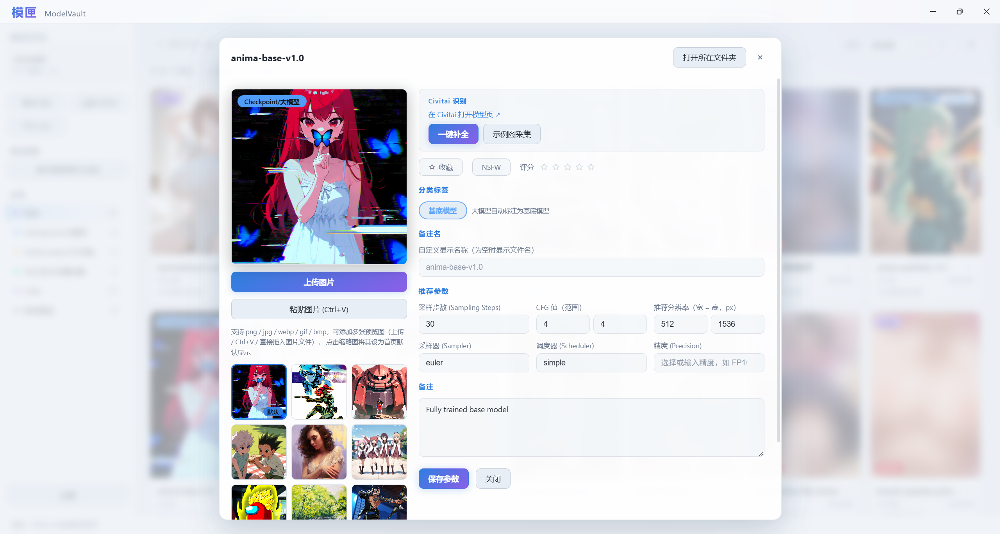
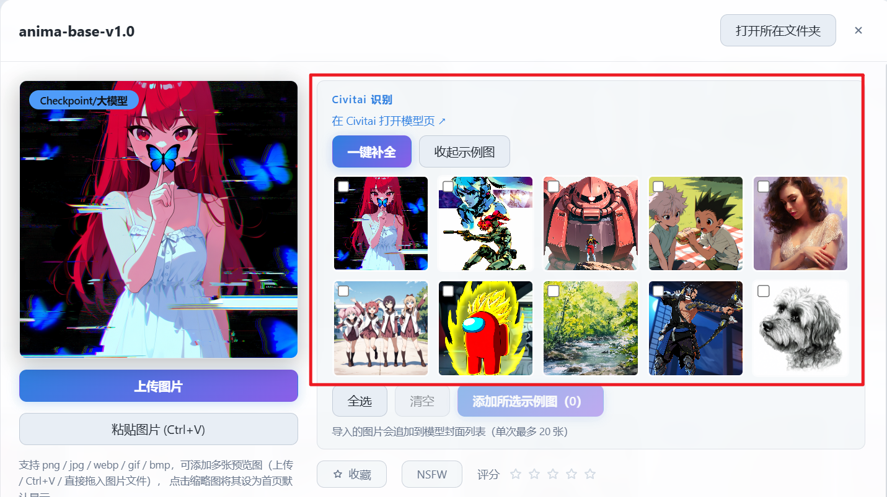
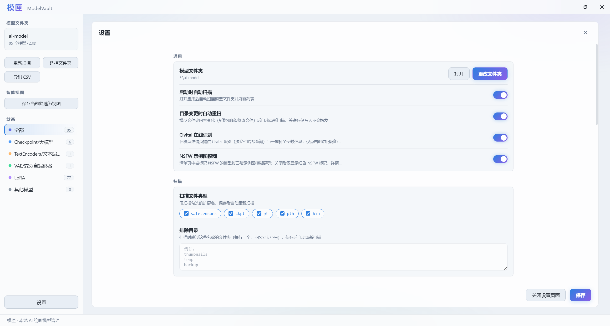

# ModelVault（模匣）


基于 **Electron + Vite + Vue 3** 的 Windows 平台本地 AI 绘画模型管理软件，单文件便携 EXE，开箱即用。

## 目录

- [核心功能](#核心功能)
- [界面展示](#界面展示)
- [快速开始](#快速开始)
- [技术栈](#技术栈)
- [键盘与鼠标快捷键](#键盘与鼠标快捷键)
- [常用脚本](#常用脚本)
- [打包说明](#打包说明)
- [项目结构](#项目结构)
- [开发指南](#开发指南)
- [安全要点](#安全要点)

## 核心功能

### 模型管理

- **扫描与自动分类**：递归扫描 `.safetensors` / `.ckpt` / `.pt` / `.pth` / `.bin`，按名称关键词自动分类为 Checkpoint / TextEncoders / VAE / LoRA，其余归入「其他模型」；支持二级分类标签、LoRA 标签（角色/风格/概念等）与 Checkpoint 基底模型标注；进度展示、随时取消、可排除目录
- **多模型库**：保存多个模型根目录，侧栏一键切换；每个库的元数据与封面相互独立
- **目录监控**：可选开启变更自动重扫——轮询快照比对（条目增删/重命名）+ 低频内容校验（同名覆盖写入），防抖合并后变更子树走局部增量扫描就地合并，不误触发关联写入
- **文件管理**：删除移入系统回收站并清理关联数据、打开所在文件夹、复制路径/推荐参数、原生右键菜单
- **重复检测**：后台按体积预筛预热 SHA256（默认只计算大小相同的候选模型，避免全库读盘；可在设置中切换「全库预热/关闭」），渐进就绪无需重扫；内容完全相同的重复模型以角标提示，一键筛选重复项（按哈希分组聚拢），智能保留评分/收藏/最新最优副本、冗余副本批量移入回收站

### 浏览与标注

- **双视图浏览**：网格/列表切换，虚拟滚动支撑数千模型流畅浏览；缩略图后台缓存、多预览图悬停轮播；「智能视图」可保存当前搜索/筛选/排序组合，侧栏一键切换
- **搜索与筛选**：按名称/备注/触发词搜索，按分类与收藏筛选，多种排序；搜索框支持结构化语法（与筛选叠加）：`base:pony`（基底家族）、`tag:"我的标签"`、`type:lora`、`size:>1gb`、`score:>=4`、`fav:yes`、`nsfw:no`，多个条件 AND 组合
- **封面管理**：上传 / Ctrl+V 粘贴 / 拖拽导入多张预览图，可设默认封面，自动识别同名 sidecar 图，孤儿文件自动清理
- **收藏 / 评分 / NSFW**：星标收藏、五星评分即时保存；NSFW 模型封面默认模糊展示（可关闭）
- **标签管理**：设置页对全库自由标签重命名/合并/移除，整库生效并即时落盘（目标名已存在时自动合并）
- **推荐参数**：为每个模型保存采样步数、CFG、采样器、调度器、精度、推荐分辨率区间与备注

### 批量与在线

- **批量操作**：`Ctrl+点击` 快速多选、`Shift+点击` 范围选择（与资源管理器同语义）；批量收藏/评分/NSFW/标签/触发词填充/Civitai 识别/禁用/删除；长耗时批量可随时 `Esc` 请求取消并保留已完成部分
- **Civitai 在线识别**：按文件 SHA256 反查模型版本，一键补全空缺的触发词与备注（绝不覆盖已有标注），可勾选示例图批量导入为封面；哈希结果持久缓存并由后台队列预热，首次识别也可秒级返回
- **应用内检查更新**：设置页一键查询 GitHub Releases 最新版本

### 数据与体验

- **关联存储**：界面设置（主题/视图/智能视图/扫描规则等）与封面、参数、备注等用户数据全部保存在模型根目录的 `.modelvault/` 内，按相对路径关联，随文件夹移动/复制保持关联——换电脑打开即恢复完整配置；库内移动/重命名后重扫时自动重关联元数据（宁可不绑也绝不绑错）
- **数据备份**：一键将当前库的设置与标注、封面打包为 zip，可恢复到任意模型文件夹
- **体验细节**：亮/暗/跟随系统主题（同步原生标题栏）、强调色预设与自定义、卡片尺寸与展示内容配置、详情页全屏画廊、窗口尺寸位置记忆

## 界面展示

**模型浏览**：卡片式首页，左侧分类筛选与计数、顶部搜索与排序，扫描全程异步不阻塞 UI。


**模型详情**：上传/粘贴封面图片、编辑推荐参数与备注。



**Civitai模型站识别**：一键识别Civitai模型站对应链接并获取示例图。



**软件设置**：支持丰富的自定义设置内容。



## 快速开始

环境要求：Windows 10 及以上，Node.js ≥ 22.22.2（`package.json` `engines` 强制要求）。

```bash
# 1. 安装依赖
npm install

# 2. 启动开发模式（热重载）
npm start
```

## 技术栈

| 组件             | 版本 | 说明                                   |
| ---------------- | ---- | -------------------------------------- |
| Electron         | ^44  | 跨平台桌面运行时                       |
| electron-vite    | ^5   | 构建/开发工具链，内置 HMR 热重载       |
| Vue 3            | ^3.5 | 渲染进程前端框架                       |
| electron-builder | ^26  | Windows 打包（portable 单文件便携版）  |
| Vite             | ^7   | 底层构建引擎                           |
| vitest           | ^5   | 单元测试（主进程 + 渲染层 store/组件） |

## 键盘与鼠标快捷键

| 操作              | 快捷键                    | 说明                                                         |
| ----------------- | ------------------------- | ------------------------------------------------------------ |
| 聚焦搜索框        | `Ctrl+F`                  | 全局可用（面板打开或未选文件夹时无效）                       |
| 进入多选并全选    | `Ctrl+A`                  | 作用于当前筛选结果；输入框内保持原生全选                     |
| 退出多选          | `Esc`                     | 批量进行中先**请求取消**（保留已完成部分）；无多选时清空搜索 |
| 批量收藏          | `Ctrl+D`                  | 多选模式批量收藏；详情打开时收藏当前模型                     |
| 批量删除          | `Delete`                  | 多选模式移入系统回收站（弹确认层）                           |
| 快速勾选          | `Ctrl+点击`               | 非多选模式直接进入多选并选中该卡片/行                        |
| 范围选择          | `Shift+点击`              | 从上次点击项范围选中（与资源管理器同语义）                   |
| 网格/列表导航     | `方向键` / `Home` / `End` | 移动焦点卡片/行                                              |
| 激活焦点项        | `Enter` / `Space`         | 打开详情；多选模式下切换选中                                 |
| 收藏 / 删除焦点项 | `F` / `Delete`            | 焦点卡片快速收藏；弹出删除确认                               |

> 输入控件（搜索框/文本域/下拉）内除 `Ctrl+F` 外均不拦截按键，保持原生文本编辑行为。

## 常用脚本

| 命令                        | 说明                                             |
| --------------------------- | ------------------------------------------------ |
| `npm start` / `npm run dev` | 启动开发模式（主进程/渲染进程热重载）            |
| `npm run build`             | 编译主进程、preload、渲染进程到 `out/`           |
| `npm run lint`              | ESLint 代码检查（flat config，错误级规则）       |
| `npm run typecheck`         | TypeScript checkJs 类型检查（shared 契约层 + preload，渐进扩展） |
| `npm test`                  | 运行单元测试（vitest，`test:watch` 为监视模式）  |
| `npm run test:coverage`     | 运行单元测试并生成覆盖率报告（含防退化阈值门禁） |
| `npm run preview`           | 以生产构建产物启动应用预览                       |
| `npm run dist`              | 编译并打包单文件便携版 EXE 到 `dist/{version}/`  |
| `npm run dist:dir`          | 编译并生成免安装目录（快速验证打包结果）         |

## 打包说明

- 打包配置见 `electron-builder.yml`（portable 单文件便携版，x64），产物为 `dist/{version}/ModelVault-{version}.exe`
- 单文件 EXE 运行时不在其所在目录生成任何文件：引导信息（库列表/激活库）与日志保存在 `%APPDATA%\modelvault\`，库设置与模型元数据随库保存在用户选择的模型文件夹
- 首次启动需解压到系统临时目录，启动速度略慢于常规安装版；Windows 10+ 可直接运行，无额外运行时依赖
- 如需更换应用图标，替换 `build/icon.ico`（需包含 256×256 及以上尺寸）；也可临时放置 512×512 以上的正方形 `icon.png` 到 `build/`，运行 `node scripts/generate-icon.mjs` 生成多尺寸 ico（源图不入库）

## 项目结构

```
ModelVault/
├── build/                        # 打包资源：应用图标 icon.ico
├── image/                        # 软件界面截图（README 展示用）
├── .github/workflows/            # CI 质量门禁（ci.yml）+ 标签发布构建（release.yml）
├── scripts/                      # 工具脚本（应用图标生成 / CSP 检查）
├── src/
│   ├── shared/                   # 主/渲染进程共享常量（分类标签/扩展名/默认设置/枚举）
│   ├── main/                     # 主进程
│   │   ├── index.js              # 应用入口：生命周期、单实例锁、全局错误处理
│   │   ├── windows/mainWindow.js # 主窗口创建/管理（窗口状态记忆、WCO 标题栏）
│   │   ├── menu.js               # 窗口级快捷键（无原生菜单栏模式）
│   │   ├── ipc.js                # IPC 处理器注册入口（应用信息/主题/异常上报）
│   │   ├── ipc/models/           # 模型管理 IPC 处理器（按域拆分：scan/decorate/covers/
│   │   │                         #   meta/misc/files/civitai/backup/store/model-state）
│   │   ├── protocol.js           # mvimg:// / civimg:// 自定义图片协议（白名单校验）
│   │   ├── fatal-error.js / quit.js / theme.js / logger.js / utils.js
│   │   └── services/             # 主进程服务层：扫描分类、关联存储（.modelvault/）、
│   │                             #   原子写入、元数据重关联、目录监控、封面/缩略图、
│   │                             #   备份恢复、检查更新、Civitai 客户端、哈希预热、
│   │                             #   safetensors 头部解析等
│   ├── preload/index.js          # 预加载脚本：contextBridge + IPC 通道白名单
│   └── renderer/                 # 渲染进程（Vue 3）
│       └── src/
│           ├── App.vue / main.js / error-report.js  # 根组件 / 入口 / 错误上报链路
│           ├── constants/        # 推荐参数常量、强调色预设
│           ├── store/            # 全局响应式状态（按域拆分：筛选/库切换/批量/
│           │                     #   增量扫描/封面/Civitai/智能视图/派生数据等）
│           └── components/       # TopBar / Sidebar / VirtualModelGrid / VirtualModelList /
│                                 #   ModelCard / ModelDetail（含 detail/ 封面面板、
│                                 #   AutoInfoPanel、CivitaiPanel、CoverGallery）/
│                                 #   BatchBar / ConfirmOverlay / StatsSection /
│                                 #   SettingsPage / ToastHost
├── tests/                        # vitest 单元测试（主进程 + 渲染层 store 与组件）
├── electron.vite.config.mjs      # electron-vite 配置
├── electron-builder.yml          # 打包配置（portable 单文件）
└── package.json
```

## 开发指南

### 主进程与渲染进程通信

渲染进程**没有**裸 `invoke` 入口，所有 invoke 通道必须在 `src/shared/ipc-schema.js` 注册表登记（单一来源：preload 白名单由注册表键集派生，payload schema 一并声明，未登记通道被 fail-closed 拒绝）：

1. 在 `src/shared/ipc-schema.js` 的 `IPC_PAYLOAD_SCHEMAS` 中登记通道：带参通道用 `vObj`/`vStr` 等构造器声明 payload 结构门禁，无参通道登记 `vVoid()`：

```js
'my:channel': vObj({ fields: { id: vStr({ required: true, max: 2000 }) } })
```

2. 在 `src/main/ipc.js` 或 `src/main/ipc/models/` 对应域模块中注册处理器（统一经 `wrapHandler`，自动执行 schema 前置校验与异常兜底；事件推送类通道加入 preload 的 `VALID_RECEIVE_CHANNELS`）：

```js
wrapHandler('my:channel', async (event, payload) => {
  return 'result'
})
```

3. 在 `src/preload/index.js` 的 `api` 对象中添加语义化方法（内部统一走 `invokeValidated` / `subscribe`），渲染进程通过 `window.api.myDomain.doThing(payload)` 调用。

> 通道登记与两侧调用/注册点的一致性由 `tests/ipcSchema.test.js` 双向对账锁定，任一侧漏改即测试失败。

### 类型检查

项目为纯 JavaScript，以 TypeScript 编译器 `checkJs` 模式做**纯类型检查**（`npm run typecheck`，无构建产物）：`tsconfig.json` 当前覆盖 `src/shared/`（IPC 通道单一来源注册表、默认设置等跨进程契约）与 `src/preload/`，`strict` 关闭以聚焦真实类型错误。覆盖范围与严格度按棘轮渐进扩展至主进程与渲染层；为共享模块补写 JSDoc 类型标注（如 `SchemaRule` typedef）即可让检查器捕获字段改名/漏改类回归。

### 快捷键与窗口

应用不显示原生菜单栏，快捷键在 `src/main/menu.js` 中通过 `before-input-event` 窗口级注册：`F11` 全屏切换；DevTools 与刷新快捷键**仅在开发环境生效**。窗口统一在 `src/main/windows/` 管理，可参照 `mainWindow.js` 创建多窗口。

### 日志

- 位置：`%APPDATA%\modelvault\logs\modelvault-YYYY-MM-DD.log`（按天分文件，保留 14 天）
- 用法：`import logger from './logger'` 后调用 `logger.info / warn / error`
- 主进程全局异常自动记录；渲染进程异常经 `app:reportError` 通道上报写入同一日志，同类错误节流降噪

### 测试

单元测试位于 `tests/`（51 个文件 / 790+ 用例）：主进程纯逻辑与 IPC handler（node 环境）、渲染层 store 按域拆分测试、组件交互测试（`@vue/test-utils` + jsdom，文件头 `// @vitest-environment jsdom` 声明）。Electron API 在 `tests/setup.js` 中统一 mock，公共挂载/IPC 脚手架在 `tests/helpers/` 中复用。新增纯函数模块或组件交互时请同步补充用例，运行 `npm test` 验证；`npm run test:coverage` 受防退化阈值门禁约束（Statements 80.8% / Branches 73.3% / Functions 77.7% / Lines 82.8%，棘轮渐进上调），store-meta/store-settings/watcher/backup 等数据完整性关键服务另有 per-file 覆盖率地板（见 `vitest.config.mjs`）。

### CI 与发版

- `ci.yml`：push 到 main / PR 时运行质量门禁（Node 22/24 矩阵：ESLint → 类型检查 → 单元测试 → 三端编译 → 产物完整性校验 → 覆盖率归档）
- `release.yml`：推送 `v*` 标签触发 Windows 打包，自动创建 GitHub Release 并附加 EXE 与 SHA256 校验和

## 安全要点

- `contextIsolation: true` + `nodeIntegration: false` + `sandbox: true`，渲染进程无 Node 能力；preload 仅暴露白名单通道
- `mvimg://` 图片协议仅允许访问当前模型根目录内文件（越界返回 403）；`civimg://` 远程图片代理仅放行 Civitai 官方 CDN 域名白名单（https 强制，防 SSRF）
- 渲染进程导航一律拦截，外部链接经系统浏览器打开；HTML 含 CSP 策略
- 模型删除移入系统回收站（非永久删除）；扫描根目录白名单校验；封面导入有图片魔数校验与大小预检
- 开发类快捷键（DevTools/刷新）在生产环境禁用
